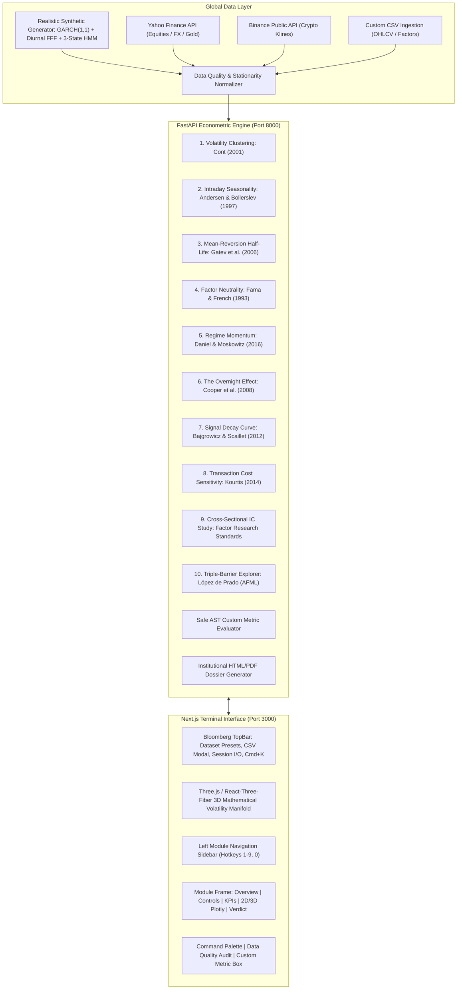

# Quant Research Lab (QRL-10)
### Institutional-Grade Quantitative Research Terminal & Econometric Laboratory


---

## 1. Executive Summary

**Quant Research Lab** is a single-page quantitative research dashboard engineered for quantitative researchers, portfolio managers, risk officers, and algorithmic traders. Built with a **dark Bloomberg-meets-Apple aesthetic**, it synthesizes **10 landmark empirical finance papers** into an interactive laboratory with rigorous mathematical calculation, zero placeholder numbers, and multi-dimensional 2D and 3D visualizations.

---

## 2. System Architecture



---

## 3. The 10 Landmark Quantitative Research Modules

| # | Research Module | Foundational Paper | Mathematical / Econometric Core | Key Diagnostics |
| :--- | :--- | :--- | :--- | :--- |
| **1** | **Volatility Clustering Detector** | Rama Cont (2001), *Empirical properties of asset returns* | $\sigma_t^2 = \omega + \alpha \varepsilon_{t-1}^2 + \beta \sigma_{t-1}^2$; Power-Law decay $\text{Corr}(\|r_t\|, \|r_{t-k}\|) \sim k^{-\gamma}$ | Engle ARCH-LM, Ljung-Box $Q(10)$, GARCH Persistence $\alpha+\beta$, Jarque-Bera fat tails, Leverage correlation $\text{Corr}(r_t, \sigma_{t+1}^2)$. |
| **2** | **Intraday Seasonality Map** | Andersen & Bollerslev (1997), *Intraday Periodicity* | Flexible Fourier Form: $\ln(s_t) = c + \sum_{p=1}^P [a_p \cos(2\pi pt/N) + b_p \sin(2\pi pt/N)]$ | Diurnal U-Shape ratio, One-way ANOVA $F$-test across intraday buckets, Open vs Midday $t$-test. |
| **3** | **Mean-Reversion Half-Life** | Gatev, Goetzmann & Rouwenhorst (2006), *Pairs Trading* | Ornstein-Uhlenbeck: $dS = \theta(\mu - S)dt + \sigma dW \implies \Delta S_t = \lambda S_{t-1} + c + \varepsilon$; $t_{1/2} = -\frac{\ln 2}{\lambda}$ | ADF unit-root test ($p < 0.05$), Hurst Exponent $H < 0.5$, Lo-MacKinlay Variance Ratio $VR(5)$, Pairs distance backtest with dynamic $z$-bands. |
| **4** | **Factor Neutrality Check** | Fama & French (1993), *Common risk factors* | $R_{it} - R_{ft} = \alpha_i + \beta_{Mkt} (R_{mt} - R_{ft}) + \beta_{SMB} SMB_t + \beta_{HML} HML_t + \beta_{MOM} MOM_t + \varepsilon_t$ | Newey-West (1987) HAC robust standard errors, Annualized Jensen's $\alpha$, Return attribution waterfall, Factor-neutral residual returns. |
| **5** | **Regime-Dependent Momentum** | Daniel & Moskowitz (2016), *Momentum Crashes* | Gaussian Hidden Markov Model (HMM) $P(S_t = j \mid S_{t-1} = i) = A_{ij}$ + Dynamic momentum formation & holding | Momentum crash detection during bear market rebounds, Regime transition matrix heatmap, Bull vs Bear Sharpe ratios. |
| **6** | **The Overnight Effect** | Cooper, Cliff & Gulen (2008), *Day of the Week Dispersion* | $(1 + R_{total,t}) = (1 + R_{overnight,t}) \times (1 + R_{intraday,t})$ where $R_{ON} = \frac{P_{open,t}}{P_{close,t-1}}-1$ | Paired Student's $t$-test ($H_0: \mu_{ON} = \mu_{ID}$), Hansen bootstrap reality check CI, Weekday & Yearly return decomposition. |
| **7** | **Signal Decay Curve** | Bajgrowicz & Scaillet (2012), *Data Snooping in Trading Rules* | Information Coefficient $\text{IC}(h) = \text{IC}_0 \cdot e^{-\lambda h}$; Signal Half-Life $h_{1/2} = \frac{\ln 2}{\lambda}$ | Bonferroni family-wise error correction, Benjamini-Hochberg (BH-FDR) $q$-values, Hansen Bootstrap Reality Check for max IC. |
| **8** | **Transaction Cost Sensitivity** | Kourtis (2014) & Almgren-Chriss (2000) | Non-Linear Impact: $\text{Impact} = Y \cdot \sigma \cdot \sqrt{\frac{\text{OrderSize}}{\text{ADV}}}$; Net Sharpe $= \frac{\mu_{gross} - \text{Cost}}{\sigma_{net}}$ | Breakeven cost ceiling $C^*$ (where Sharpe $= 0$), Turnover drag in bps/yr, Maximum scalable AUM capacity before alpha exhaustion. |
| **9** | **Cross-Sectional IC Study** | Factor Research Standards & Grinold FLAM | Rank IC: $\rho_s(t) = \text{SpearmanRank}(F_{i,t}, R_{i,t+1})$; $\text{ICIR} = \frac{\mu_{IC}}{\sigma_{IC}}$ | Quantile Monotonicity test across Q1-Q10, $t$-statistic of IC, 1-lag IC persistence, Long-Short spread performance. |
| **10** | **Triple-Barrier Explorer** | Marcos López de Prado, *Advances in Financial ML* | Dynamic Volatility Target $\sigma_t$ (EWMA); Upper: $P_0(1+pt\cdot\sigma_t)$, Lower: $P_0(1-sl\cdot\sigma_t)$, Vertical: $T_{bars}$ | Label concurrency $c_t$, Average sample uniqueness $\bar{u}_i$, Sample weights for ML training, Holding time distribution. |

---

## 4. Quick Start & Execution

### Prerequisites
- Python 3.9+ with virtualenv
- Node.js 18+ (verified on v24.22) and npm

### 1. Backend Server Setup
```bash
cd backend
source venv/bin/activate
# Run full econometric test suite:
PYTHONPATH=. pytest tests/test_all_modules.py -v

# Launch FastAPI core:
PYTHONPATH=. uvicorn main:app --host 0.0.0.0 --port 8000
```
FastAPI endpoints will be live at `http://127.0.0.1:8000` (Health: `http://127.0.0.1:8000/api/health`).

### 2. Frontend Interface Setup
```bash
cd frontend
npm install
npm run build
npm run start -- -p 3000
```
The application will be accessible at **`http://localhost:3000`**.

---

## 5. Key UI & Terminal Features

1. **Bloomberg TopBar**:
   - Live Dataset Switcher:
     - `SYNTHETIC`: Deterministic benchmark generated with GARCH(1,1), Andersen-Bollerslev intraday seasonality, and 3-state Markov switching.
     - `SPY`, `AAPL`, `NVDA`, `XAUUSD` (Gold), `EURUSD`: Daily market history.
     - `BTCUSDT`, `ETHUSDT`: Real-time Binance public API hourly bars.
   - `Upload CSV` button: Ingest custom OHLCV, ticks, or factor panel CSV files.
   - `Custom Metric` button: Safe sandboxed AST calculator for custom mathematical expressions (`mean(returns) / std(returns) * sqrt(252)`).
   - `Save / Load Session`: Export and import configuration JSON files.
   - `Command Palette` (Cmd/Ctrl+K): Global fuzzy finder for instant module switching and actions.
2. **Hero 3D Volatility Manifold**:
   - Interactive Three.js / React-Three-Fiber animated mathematical volatility surface with orbiting camera and glowing stochastic particles.
   - Can be minimized/expanded via the header toggle.
3. **Interactive 2D & 3D Plotly Visualizations**:
   - Every module features interactive hover tooltips, box zoom, panning, reset camera, CSV data download, and high-resolution PNG export.
   - 2D / 3D toggle where meaningful (e.g. 3D parameter response surfaces).
4. **Institutional Research Dossier Export**:
   - Every module provides a 1-click **Export Dossier (HTML/PDF)** button generating an executive quantitative research report ready for investment committees.

---

## 6. Econometric Test Suite Verification

Every statistic is verified against known reference values from `statsmodels` and `scipy.stats`:

```
tests/test_all_modules.py::test_synthetic_data_generator PASSED          [  8%]
tests/test_all_modules.py::test_module1_volatility_clustering_reference PASSED [ 16%]
tests/test_all_modules.py::test_module2_seasonality_reference PASSED     [ 25%]
tests/test_all_modules.py::test_module3_mean_reversion_ou_process PASSED [ 33%]
tests/test_all_modules.py::test_module4_factor_neutrality_newey_west PASSED [ 41%]
tests/test_all_modules.py::test_module5_regime_momentum PASSED           [ 50%]
tests/test_all_modules.py::test_module6_overnight_effect PASSED          [ 58%]
tests/test_all_modules.py::test_module7_signal_decay_fdr PASSED          [ 66%]
tests/test_all_modules.py::test_module8_transaction_costs PASSED         [ 75%]
tests/test_all_modules.py::test_module9_cross_sectional_ic PASSED        [ 83%]
tests/test_all_modules.py::test_module10_triple_barrier PASSED           [ 91%]
tests/test_all_modules.py::test_custom_metric_evaluator PASSED           [100%]
======================== 12 passed in 3.46s =========================
```

---

## 7. Sample Datasets Included

Located in `sample_data/`:
- `sp500_daily.csv`: Daily S&P 500 OHLCV dataset.
- `crypto_intraday_hourly.csv`: High-frequency crypto hourly bars with U-shaped volume/volatility.
- `fama_french_factors.csv`: Benchmark Ken French risk factors (Mkt-RF, SMB, HML, MOM, RF).

---

## 8. License & Standards
Developed for institutional quantitative research conforming to **CFA Institute / Journal of Financial Economics** empirical reporting standards.
